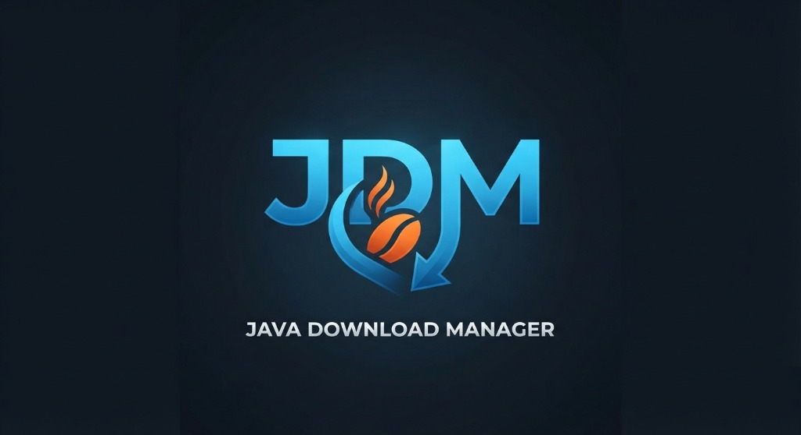

<p align="center">
  
</p>

<h1 align="center">JDM — Java Download Manager (Accelerated Pro)</h1>

<p align="center">
  <strong>The Ultimate Free & Open-Source Alternative to Internet Download Manager (IDM) for Windows</strong><br>
  <em>Accelerate download speeds up to 10x with multi-connection byte-range segmentation, zero-copy assembly, and Chrome extension integration.</em>
</p>

<p align="center">
  
  
  
  
  
</p>

---

## ⚡ Why Choose JDM over Browsers and Paid Download Managers?

Standard web browsers download files through a single, slow TCP channel. Commercial download managers cost high recurring license fees. **JDM (Java Download Manager)** is 100% free, privacy-friendly, and engineered for maximum speed.

### 📊 Feature Comparison

| Feature | Standard Browser (Chrome / Edge) | Commercial IDM ($24.95) | **JDM (Free & Open Source)** |
| :--- | :---: | :---: | :---: |
| **Download Speed** | 1x (Single thread) | Up to 10x | **Up to 10x (1–32 Parallel Streams)** 🚀 |
| **Pause & Resume** | ⚠️ Unreliable | ✅ Yes | **✅ Rock-Solid Offset Recovery** |
| **File Assembly Overhead** | None | ⏳ Slow post-download merge | **⚡ Instant Zero-Copy (`FileChannel`)** |
| **Video Stream Sniffer** | ❌ No | ✅ Yes | **✅ Yes (Floating Button & Dropdown)** |
| **Chrome Extension** | N/A | Manifest V2 (Outdated) | **✅ Manifest V3 Modern Integration** |
| **User Interface** | Basic tab | Legacy Windows 98 Look | **✨ Modern Rounded Dark Theme (FlatLaf)** |
| **License & Price** | Free | 💰 $24.95 / Yearly Fee | **🎉 100% Free Forever (MIT License)** |
| **Open Source** | Closed | Closed Source | **🔓 100% Transparent & Verifiable** |

---

## 🚀 Key Performance Architecture

### 1. Dynamic Parallel Segmentation (1 to 32 Connections)
- Automatically probes servers for partial content support (`Accept-Ranges: bytes` & HTTP 206).
- Splits files into $N$ simultaneous parallel byte-range streams, multiplying throughput and bypassing server-side throttling.

### 2. Zero-Copy Instant Assembly (`java.nio.channels.FileChannel`)
- Traditional downloaders download fragmented files (`.part1`, `.part2`) and freeze your computer while merging them at 100%.
- JDM pre-allocates the file and uses high-speed thread-safe positioned writes. **The exact millisecond the final chunk finishes, your file is 100% ready to open.**

### 3. Fail-Safe Pause & Resume Engine
- Saves byte checkpoints in real-time (`.idm_meta`).
- Pause any download, close the application, shut down your PC, and resume seamlessly right where you left off.

---

## 🌟 Highlights & Capabilities

- **Real-Time Visual Segment Bar**: Live color-coded visualization showing the byte progress of every parallel thread.
- **Chrome Integration Module**: Intercepts browser downloads, adds right-click context menus, and detects active media streams.
- **Automatic Video Grabber**: Floating download button on video players with instant format/resolution stream selection.
- **Clipboard Sniffer**: Automatically catches copied URLs from your clipboard and prompts you to download.
- **Smart Queue & Bandwidth Limiter**: Limit concurrent active tasks and set custom speed caps.
- **System Tray Minimization**: Runs quietly in the background without cluttering your taskbar.

---

## 🖥️ Quick Start & Installation

### Option 1: Instant Launch (No Installation Required)
Simply double-click **`run.bat`** (or directly launch **`IDM-Java.jar`**):
```cmd
run.bat
```
*(Uses `javaw.exe` so JDM launches silently without opening a terminal window).*

### Option 2: Add Desktop Shortcut
Right-click `create_desktop_shortcut.ps1` ➔ **"Run with PowerShell"**:
```powershell
powershell -ExecutionPolicy Bypass -File .\create_desktop_shortcut.ps1
```

### Option 3: Command-Line Downloader
Download any URL directly from your command line:
```cmd
run.bat https://example.com/archive.zip
```

---

## 🌐 Chrome Extension (JDM Integration Module)

A dedicated Manifest V3 Chrome Extension is included in [`chrome-extension/`](chrome-extension/).

### 3-Step Setup in Google Chrome:
1. Double-click `install_chrome_extension.bat` (or open `chrome://extensions`).
2. Turn on **Developer mode** in the top-right corner.
3. Click **"Load unpacked"** and select the [`chrome-extension`](chrome-extension/) folder.
4. Done! Every download link and video stream in Chrome will now route through JDM.

---

## ❓ Frequently Asked Questions (FAQ)

<details>
<summary><b>Why does the Chrome extension say "Offline"?</b></summary>
The extension is a companion remote control that communicates with JDM on your computer. Simply open JDM (run <code>run.bat</code>) and the extension will immediately show <b>🟢 Connected</b>.
</details>

<details>
  *******Notes:- When downloading youtube Videos from browser download directly from extension.(click the JDM extension and you will see the download videos option there).*******
<summary><b>Can JDM download YouTube videos?</b></summary>
JDM sniffs and downloads all direct video and audio streams (MP4, MKV, WebM, FLV, HLS .m3u8). For YouTube, high-resolution streams (1080p, 4K) are split by YouTube into separate encrypted video and audio channels that require stream multiplexing. JDM downloads standard web streams and direct video files directly.

</details>

<details>
<summary><b>Does JDM work on Windows 10 and Windows 11?</b></summary>
Yes! JDM includes native FlatLaf dark themes optimized for modern Windows 10 and 11 with High-DPI screen support.
</details>

---

## 🛠️ Build from Source

```cmd
build.bat
```
Compiles with `javac` and packages the standalone executable FAT-JAR `IDM-Java.jar`.

---

## 📁 Repository Structure

```
JavaDownloadManager/
├── IDM-Java.jar                 # Standalone executable FAT-JAR (bundled with FlatLaf & icons)
├── assets/                      # Official high-resolution brand banners & logos
│   ├── logo-banner.png          # Presentation banner (1024x558)
│   └── logo-square.png          # Square brand emblem
├── resources/                   # Multi-resolution icons (16px to 256px)
├── chrome-extension/            # Dedicated Chrome Extension (Manifest V3)
│   ├── manifest.json            # Extension metadata
│   ├── background.js            # Network sniffer & download interceptor
│   ├── content.js               # Floating video download button
│   └── popup.html               # Popup control center
├── run.bat                      # Silent launcher script
├── build.bat                    # One-click compiler & packager
├── create_desktop_shortcut.ps1  # Windows desktop shortcut creator
├── flatlaf-3.5.4.jar            # Modern UI theme library
└── src/com/idm/                 # Clean Java modular source code
```

---

## 🏷️ Keywords & Topics
`idm-alternative` • `internet-download-manager` • `download-manager` • `download-accelerator` • `java-download-manager` • `multithreaded-downloader` • `chrome-extension` • `video-downloader` • `hls-downloader` • `file-downloader` • `flatlaf` • `windows-app` • `open-source-idm`
